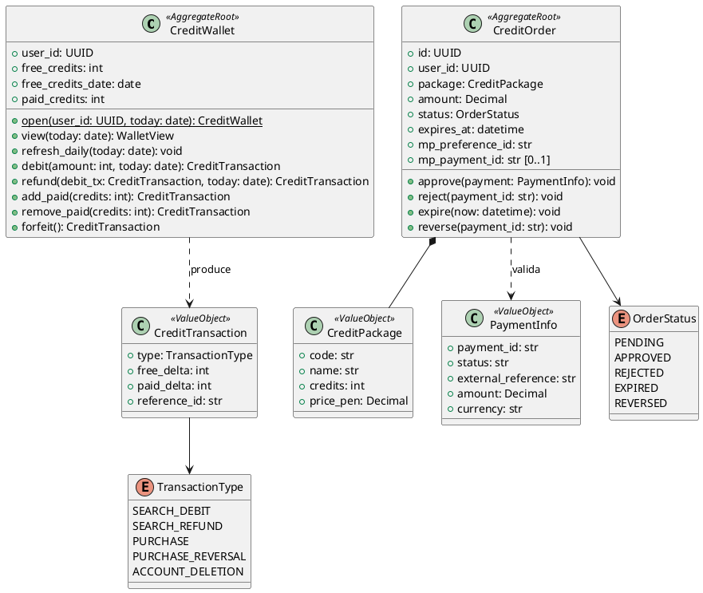

# Bounded Context: Billing (`src/modules/billing/`)

## 1. Propósito y límites

Administra los créditos del usuario: 10 gratuitos por día, créditos comprados, el débito de 5 por búsqueda, los reembolsos de búsquedas fallidas y la compra de paquetes con Mercado Pago (solo en soles).

**No hace:** suscripciones, boletas electrónicas (pendiente legal RL-04), reembolsos de dinero, ajustes manuales de saldo ni correos de recibo (Mercado Pago envía el suyo). Tampoco decide cuándo cobrar: eso lo decide Quotes (RN-08).

Reglas: RN-08, RN-09, RN-17, RL-02, RL-04 y la sección 7 de [navby-documentation.md](../../navby-documentation.md).

## 2. Lenguaje ubicuo

| Término | Significado |
| :--- | :--- |
| **Billetera** | Saldo de un usuario: créditos gratuitos del día y créditos comprados. Existe solo para usuarios con correo verificado. |
| **Día de créditos** | Fecha calendario en la zona `America/Lima`. Los gratuitos se reponen a las 00:00 de Lima. |
| **Créditos gratuitos** | 10 por día de créditos. No se acumulan. |
| **Créditos comprados** | Perpetuos. Se consumen después de los gratuitos. |
| **Transacción** | Registro inmutable de un débito, un reembolso, una compra o una anulación. |
| **Orden** | Intención de compra de un paquete, vinculada a una preferencia de Mercado Pago. |

## 3. Capa de dominio

### Agregado **CreditWallet**

| Miembro | Descripción |
| :--- | :--- |
| `user_id` | Identidad del agregado (ID lógico de IAM). |
| `free_credits` | 0–10. |
| `free_credits_date` | Día de créditos al que corresponden los gratuitos. |
| `paid_credits` | ≥ 0. |
| *open(user_id, today)* | Fábrica: 10 gratuitos con fecha de hoy y 0 comprados. |
| *view(today) -> WalletView* | Devuelve el saldo **proyectado** sin modificar nada: si `free_credits_date < today`, muestra 10 gratuitos. Lo usan las consultas. |
| *refresh_daily(today)* | Si `free_credits_date < today`: `free_credits = 10` y `free_credits_date = today`. Solo lo llaman los comandos. |
| *debit(amount, today) -> CreditTransaction* | Llama a *refresh_daily* y descuenta primero de gratuitos y luego de comprados. Si el total < amount → `INSUFFICIENT_CREDITS`. |
| *refund(debit_tx, today) -> CreditTransaction* | Devuelve los comprados siempre y los gratuitos solo si `today` es el día del débito. |
| *add_paid(credits) -> CreditTransaction* | Suma créditos comprados. |
| *remove_paid(credits) -> CreditTransaction* | Resta `min(credits, paid_credits)`. Se usa si Mercado Pago revierte un pago aprobado. |
| *forfeit() -> CreditTransaction* | Deja ambos saldos en 0. Se usa al eliminar la cuenta. |

Invariantes: ningún saldo es negativo y `free_credits ≤ 10`.

**Convención de signos:** en cada **CreditTransaction**, `free_delta` y `paid_delta` son negativos cuando restan saldo (débito, reversión, anulación) y positivos cuando suman (reembolso, compra). Un reembolso es exactamente el débito con los signos invertidos.

### Agregado **CreditOrder**

| Miembro | Descripción |
| :--- | :--- |
| `id`, `user_id` | |
| `package` | **CreditPackage**. |
| `amount` | Precio en PEN, copiado del paquete al crear la orden. |
| `status` | **OrderStatus**. |
| `expires_at` | Creación + 24 h. Es también la expiración de la preferencia de Mercado Pago. |
| `mp_preference_id`, `mp_payment_id` | Referencias de Mercado Pago. |
| *approve(payment)* | Solo desde `PENDING` y solo si `payment.amount == amount` y `payment.currency == PEN`. Si no coinciden → `PAYMENT_MISMATCH` (se registra y no se acredita). Registra **OrderApproved**. |
| *reject(payment_id)* | Solo desde `PENDING`. |
| *expire(now)* | Solo desde `PENDING` y si `now > expires_at`. |
| *reverse(payment_id)* | Solo desde `APPROVED`. Registra **OrderReversed**. |

Transiciones de **OrderStatus**:

```text
PENDING ──approved──► APPROVED ──refunded/charged_back──► REVERSED
   │
   ├──rejected/cancelled──► REJECTED
   └──vence a las 24 h────► EXPIRED
```

Cualquier otra transición se ignora: el webhook se reintenta y la operación es idempotente.

### Value objects

| Clase | Miembros | Regla |
| :--- | :--- | :--- |
| **CreditPackage** | `code`, `name`, `credits`, `price_pen` | Catálogo fijo en código: `pack_50`, `pack_100` y `pack_250` (sección 7 de producto). El precio en USD es solo informativo y no vive aquí. |
| **CreditTransaction** | `type`, `free_delta`, `paid_delta`, `reference_id` | `type` ∈ `SEARCH_DEBIT`, `SEARCH_REFUND`, `PURCHASE`, `PURCHASE_REVERSAL`, `ACCOUNT_DELETION`. |
| **PaymentInfo** | `payment_id`, `status`, `external_reference`, `amount`, `currency` | Datos que devuelve Mercado Pago al consultar el pago. |

### Eventos de dominio (internos)

| Evento | Efecto en la misma transacción |
| :--- | :--- |
| **OrderApproved** | *add_paid(package.credits)* y transacción `PURCHASE`. |
| **OrderReversed** | *remove_paid(package.credits)* y transacción `PURCHASE_REVERSAL`. |

### Repositorios

- **CreditWalletRepository**: *get(user_id)*, *get_or_open_for_update(user_id, today)* (`INSERT ... ON CONFLICT DO NOTHING` + `SELECT ... FOR UPDATE`), *save(wallet)*.
- **CreditTransactionRepository**: *add(user_id, tx)*, *find(type, reference_id)*, *list(user_id, page)*.
- **CreditOrderRepository**: *get(id)*, *get_for_update(id)*, *add(order)*, *save(order)*, *list_expired_pending(now)*.

## 4. Capa de aplicación

| Handler | Entrada | Resultado | Errores |
| :--- | :--- | :--- | :--- |
| **OpenWallet** (evento `iam.user_verified`) | `user_id` | billetera creada | — (si existe, no hace nada) |
| **ForfeitWallet** (evento `iam.user_deleted`) | `user_id` | saldos en 0 | — (idempotente) |
| **DebitSearch** | `user_id`, `search_id` | transacción y saldo restante | `INSUFFICIENT_CREDITS` |
| **RefundSearch** | `user_id`, `search_id` | transacción | — (si ya se reembolsó, no hace nada) |
| **GetWallet** (query) | `user_id` | saldo proyectado, búsquedas disponibles y próximo reinicio | — |
| **ListTransactions** (query) | `user_id`, página | transacciones, de la más reciente a la más antigua | — |
| **ListPackages** (query) | — | catálogo | — |
| **CreateOrder** | `user_id`, `package_code` | orden + `checkout_url` | `PACKAGE_NOT_FOUND` |
| **GetOrder** (query) | `user_id`, `order_id` | orden | `ORDER_NOT_FOUND` |
| **HandlePaymentNotification** | cabeceras + cuerpo del webhook | — | `INVALID_WEBHOOK_SIGNATURE` |
| **ExpirePendingOrders** (tarea cada hora) | — | órdenes vencidas | — |

Detalles:

- **Billetera perezosa:** **DebitSearch** y **GetWallet** usan *get_or_open*. Si un usuario verificado aún no tiene billetera porque el evento del outbox tarda unos segundos, se crea en ese momento. **GetWallet** no escribe en la base: si no hay fila, responde la proyección de una billetera nueva.
- **DebitSearch**: una transacción con la fila bloqueada. Inserta `SEARCH_DEBIT` con `reference_id = search_id`; la restricción `UNIQUE (type, reference_id)` impide cobrar dos veces la misma búsqueda.
- **RefundSearch**: busca el `SEARCH_DEBIT` de ese `search_id` y aplica *refund* con sus deltas invertidos.
- **CreateOrder**:
  1. Crea la orden `PENDING`.
  2. Crea la preferencia de Mercado Pago con:
     - `currency_id = PEN` y `external_reference = order_id`;
     - `expires = true` y `expiration_date_to = expires_at`;
     - `back_urls` hacia `{WEBAPP_URL}/billing/result`;
     - `notification_url` hacia `{API_PUBLIC_URL}/api/v1/billing/webhooks/mercadopago` (directo a la VM, sin pasar por Vercel).
- **HandlePaymentNotification**:
  1. Si `type` no es `payment`, responde `200` y no hace nada.
  2. Valida la firma `x-signature` y que `ts` no tenga más de 300 s de antigüedad. Si falla → `401`.
  3. Consulta el pago con *PaymentGateway.get_payment(data.id)*. Nunca confía en el cuerpo del webhook.
  4. Bloquea la orden de `external_reference` y aplica según el estado:
     - `approved` → *approve*;
     - `rejected` o `cancelled` → *reject*;
     - `refunded` o `charged_back` → *reverse*;
     - cualquier otro estado se ignora.
  5. Hace commit y responde `200`. La restricción `UNIQUE (mp_payment_id)` más la transacción `PURCHASE` con `reference_id = order_id` evitan acreditar dos veces.

### Puerto

| Puerto | Métodos | Adaptadores |
| :--- | :--- | :--- |
| **PaymentGateway** | *create_preference(order) -> (preference_id, checkout_url)*, *get_payment(payment_id) -> PaymentInfo*, *verify_signature(headers, data_id) -> bool* | `MercadoPagoPaymentGateway`, `SandboxPaymentGateway` |

## 5. Capa de interfaces

| Endpoint | Handler |
| :--- | :--- |
| `GET /billing/wallet` | **GetWallet** |
| `GET /billing/transactions` | **ListTransactions** |
| `GET /billing/packages` | **ListPackages** |
| `POST /billing/orders` | **CreateOrder** |
| `GET /billing/orders/{order_id}` | **GetOrder** |
| `POST /billing/webhooks/mercadopago` | **HandlePaymentNotification** |

Contratos en [navby-endpoints.md](../navby-endpoints.md#5-billing).

### Fachada OHS: **BillingFacade**

| Método | Retorno | Consumidor |
| :--- | :--- | :--- |
| *debit_search(user_id, search_id)* | `Result[DebitDTO(credits_charged=5, credits_remaining)]` | Quotes |
| *refund_search(user_id, search_id)* | `Result[None]` | Quotes |

## 6. Capa de infraestructura

- **PostgreSQL**: `billing.credit_wallets`, `billing.credit_transactions` y `billing.credit_orders` ([DDL y débito atómico](../navby-database-schema.md)).
- No usa Redis: el saldo vive solo en PostgreSQL y el bloqueo de fila garantiza que dos búsquedas simultáneas no gasten el mismo crédito.
- Firma del webhook: HMAC-SHA256 del manifiesto `id:{data.id};request-id:{x-request-id};ts:{ts};` con `MERCADOPAGO_WEBHOOK_SECRET`, comparado en tiempo constante con `v1` de la cabecera `x-signature`.
- Zona horaria: el «día de créditos» se calcula con `zoneinfo.ZoneInfo("America/Lima")`.

## 7. Diagrama de clases


