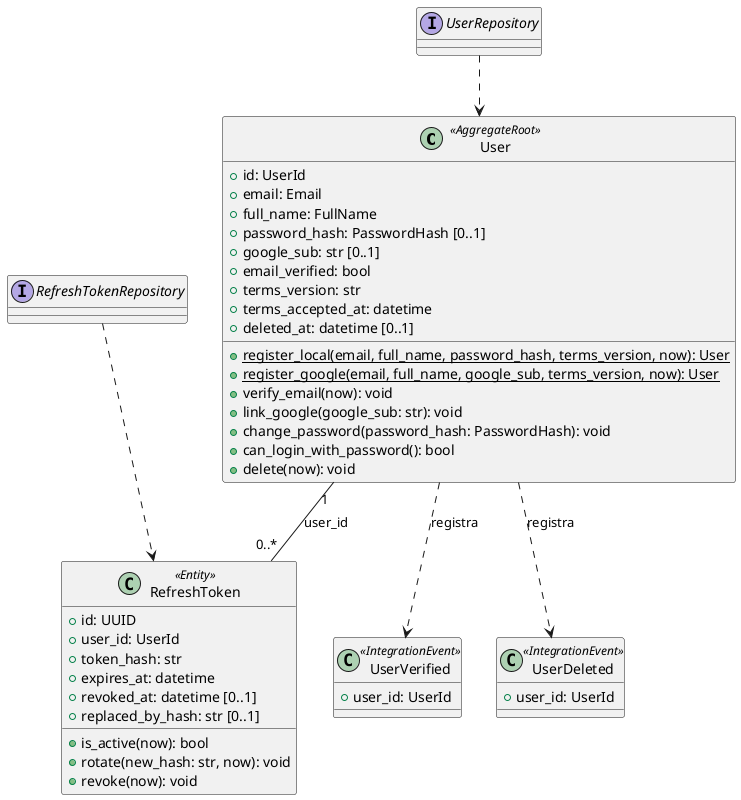

# Bounded Context: IAM (`src/modules/iam/`)

## 1. Propósito y límites

Gestiona quién es el usuario: registro con aceptación de términos y correo verificado, login local y con Google, sesiones (access token + refresh token), recuperación de contraseña y eliminación de cuenta.

**No hace:** roles ni administración, perfiles públicos, nombres de usuario, avatares ni edición de perfil. Tampoco maneja créditos: cuando el correo queda verificado publica `iam.user_verified` y Billing crea la billetera.

Reglas: RN-12, RN-17, RL-01 y RL-02 de [navby-documentation.md](../../navby-documentation.md).

## 2. Lenguaje ubicuo

| Término | Significado |
| :--- | :--- |
| **Usuario** | Persona con cuenta. Se identifica por `user_id` (UUID) y correo único. |
| **Correo verificado** | El usuario confirmó el OTP o entró con Google. Sin esto no puede iniciar sesión con contraseña ni cotizar, y no tiene billetera. |
| **OTP** | Código de 6 dígitos enviado por correo. Válido 10 min, máximo 5 intentos. |
| **Access token** | JWT HS256 de 15 min con `sub = user_id`, `email` y `ev` (correo verificado). Viaja en la cabecera `Authorization`. |
| **Refresh token** | Token opaco aleatorio de 7 días. Viaja **solo** en una cookie `HttpOnly`. Se guarda su hash SHA-256. Cada uso lo rota. |
| **Token de recuperación** | Token opaco de un solo uso, válido 30 min, enviado por enlace. |
| **Términos** | Términos de Servicio y Política de Privacidad. Su versión vigente está en la variable `TERMS_VERSION` (p. ej. `2026-10`). |

## 3. Capa de dominio

### Agregado **User**

| Miembro | Tipo | Regla |
| :--- | :--- | :--- |
| `id` | **UserId** (UUID) | Inmutable. |
| `email` | **Email** | Minúsculas, formato válido, único y de un dominio no desechable (RN-17). |
| `full_name` | **FullName** | 1–100 caracteres. |
| `password_hash` | **PasswordHash** \| None | bcrypt de 12 rondas. `None` si solo entra con Google. |
| `google_sub` | str \| None | Identificador estable de Google. |
| `email_verified` | bool | |
| `terms_version`, `terms_accepted_at` | str, datetime | Consentimiento (RL-01). Obligatorios. |
| `deleted_at` | datetime \| None | Marca de cuenta eliminada (RL-02). |
| *register_local(email, full_name, password_hash, terms_version, now)* | fábrica | `email_verified = False`. Sin eventos todavía. |
| *register_google(email, full_name, google_sub, terms_version, now)* | fábrica | `email_verified = True`. Registra **UserVerified**. |
| *verify_email(now)* | método | Si ya estaba verificado, no hace nada. Si no, lo verifica y registra **UserVerified**. |
| *link_google(google_sub)* | método | Ver reglas de vinculación abajo. |
| *change_password(password_hash)* | método | También verifica el correo (quien recibió el enlace controla el buzón). |
| *can_login_with_password()* | consulta | `password_hash` existe, `email_verified` y no eliminado. |
| *delete(now)* | método | Anonimiza: `email = deleted-{id}@navby.invalid`, `full_name = "Usuario eliminado"`, `password_hash = None`, `google_sub = None`. Marca `deleted_at` y registra **UserDeleted**. |

Invariantes:
- Un usuario activo tiene al menos un método de acceso (contraseña o Google).
- Un usuario eliminado no puede iniciar sesión ni ser reactivado.

**Reglas de vinculación con Google** (evitan el secuestro de cuentas):
1. Si existe un usuario con ese `google_sub`, se inicia sesión.
2. Si existe un usuario **verificado** con el mismo correo, se vincula `google_sub`.
3. Si existe un usuario **no verificado** con el mismo correo, Google demuestra la propiedad del buzón: se borra su `password_hash` (pudo crearlo otra persona), se vincula `google_sub` y se verifica el correo.
4. Si no existe, se crea con *register_google*.

### Entidad **RefreshToken**

`id`, `user_id`, `token_hash`, `expires_at`, `revoked_at`, `replaced_by_hash`. Métodos *is_active(now)*, *rotate(new_hash, now)* y *revoke(now)*.

### Value objects

| Clase | Validación |
| :--- | :--- |
| **Email** | RFC 5322 simplificado, ≤ 254 caracteres, se normaliza a minúsculas. |
| **PlainPassword** | 8–72 caracteres con al menos una letra y un dígito. Nunca se persiste ni se registra en logs. |
| **PasswordHash** | Cadena bcrypt (`$2b$12$...`). |
| **FullName** | 1–100 caracteres, sin espacios al inicio ni al final. |

### Eventos de integración

| Evento | Tipo | Payload | Consumidores |
| :--- | :--- | :--- | :--- |
| **UserVerified** | `iam.user_verified` | `user_id` | Billing (crea la billetera) |
| **UserDeleted** | `iam.user_deleted` | `user_id` | Billing (anula créditos) e Itineraries (borra itinerarios) |

### Repositorios

- **UserRepository**: *get_by_id(id)*, *get_by_email(email)*, *get_by_google_sub(sub)*, *add(user)*, *save(user)*.
- **RefreshTokenRepository**: *get_by_hash(hash)*, *add(token)*, *save(token)*, *revoke_all_for_user(user_id)*, *delete_expired(before)*.

## 4. Capa de aplicación

| Handler | Entrada | Resultado | Errores |
| :--- | :--- | :--- | :--- |
| **RegisterUser** | email, password, full_name, accept_terms | `user_id`. Envía el OTP. | `VALIDATION_ERROR`, `TERMS_NOT_ACCEPTED`, `DISPOSABLE_EMAIL`, `EMAIL_ALREADY_REGISTERED` |
| **VerifyEmail** | email, code | **Session** | `INVALID_OTP`, `OTP_ATTEMPTS_EXCEEDED` |
| **ResendVerification** | email | — (siempre éxito) | — |
| **LoginWithPassword** | email, password | **Session** | `INVALID_CREDENTIALS`, `EMAIL_NOT_VERIFIED` |
| **LoginWithGoogle** | id_token, accept_terms | **Session** | `INVALID_GOOGLE_TOKEN`, `TERMS_NOT_ACCEPTED` (solo si la cuenta es nueva) |
| **RefreshSession** | refresh_token (cookie) | **Session** nueva | `INVALID_REFRESH_TOKEN` |
| **Logout** | refresh_token (cookie) | — | — (idempotente) |
| **RequestPasswordReset** | email | — (siempre éxito) | — |
| **ResetPassword** | token, new_password | — | `INVALID_RESET_TOKEN`, `VALIDATION_ERROR` |
| **GetMyProfile** (query) | user_id | perfil | — |
| **DeleteMyAccount** | user_id, confirmation | — | `VALIDATION_ERROR` (la confirmación debe ser `"ELIMINAR"`) |
| **PurgeExpiredTokens** (tarea diaria) | — | filas borradas | — |

**Session** = access token (en el cuerpo) + refresh token (en la cookie) + perfil.

Detalles de los flujos:

- **RegisterUser**:
  1. Valida los datos, `accept_terms = true` y que el dominio no esté en la lista de desechables.
  2. Crea el usuario y hace commit.
  3. Envía el OTP. Si Resend falla, el registro igual responde `201` y el usuario usa *resend*.
  4. Si el correo ya existe, responde `EMAIL_ALREADY_REGISTERED`. Es una concesión consciente: revela que el correo existe, a cambio de un mensaje claro.
- **VerifyEmail**: busca por correo. Si el usuario no existe, ya está verificado o el código no coincide, responde siempre `INVALID_OTP`, para no revelar cuentas. Al quinto intento fallido borra el OTP y responde `OTP_ATTEMPTS_EXCEEDED`.
- **ResendVerification**: máximo un envío por minuto por correo. Genera un código nuevo que invalida el anterior.
- **RefreshSession**:
  - Token activo: se rota (el anterior queda revocado con `replaced_by_hash`).
  - Token revocado hace **menos de 30 s** por rotación: es una carrera entre pestañas, así que se emite una sesión nueva sin revocar nada.
  - Token revocado hace más de 30 s: posible robo. Se ejecuta *revoke_all_for_user* y se responde `INVALID_REFRESH_TOKEN`.
- **ResetPassword**: cambia la contraseña y revoca todos los refresh tokens. Los access tokens vigentes expiran solos en ≤ 15 min (riesgo aceptado).
- **DeleteMyAccount**: *delete(now)*, revoca todos los refresh tokens, borra la cookie y publica **UserDeleted** por outbox.
- **PurgeExpiredTokens**: tarea periódica (cada 24 h, iniciada en `lifespan`) que borra los refresh tokens vencidos o revocados hace más de 30 días.
- **RequestPasswordReset** y **ResendVerification** nunca revelan si el correo existe.

### Puertos (`application/acl/ports/`)

| Puerto | Métodos | Adaptadores |
| :--- | :--- | :--- |
| **PasswordHasher** | *hash(plain)*, *verify(plain, hash)* | `BcryptPasswordHasher` |
| **TokenIssuer** | *issue_access(user) -> str*, *new_refresh() -> (token, hash)* | `JwtTokenIssuer` |
| **GoogleIdentityVerifier** | *verify(id_token) -> GoogleIdentity(sub, email, email_verified, name)* | `GoogleAuthVerifier` (`google-auth`) |
| **EmailSender** | *send_verification_code(email, code)*, *send_password_reset(email, link)* | `ResendEmailSender`, `LogEmailSender` (desarrollo) |
| **OneTimeCodeStore** | *save_otp(user_id, code_hash)*, *check_otp(user_id, code) -> OtpCheck(VALID \| INVALID \| EXHAUSTED)*, *save_reset(token_hash, user_id)*, *consume_reset(token_hash) -> user_id \| None* | `RedisOneTimeCodeStore` |
| **DisposableEmailPolicy** | *is_disposable(domain) -> bool* | `FileDisposableEmailPolicy` (lista en `resources/disposable_domains.txt`, actualizable sin cambiar código) |

## 5. Capa de interfaces

| Endpoint | Handler | Rate limit |
| :--- | :--- | :--- |
| `POST /auth/register` | **RegisterUser** | `register` |
| `POST /auth/verify-email` | **VerifyEmail** | `otp` |
| `POST /auth/verify-email/resend` | **ResendVerification** | `otp` |
| `POST /auth/login` | **LoginWithPassword** | `login` |
| `POST /auth/google` | **LoginWithGoogle** | `login` |
| `POST /auth/refresh` | **RefreshSession** | — |
| `POST /auth/logout` | **Logout** | — |
| `POST /auth/forgot-password` | **RequestPasswordReset** | `forgot_password` |
| `POST /auth/reset-password` | **ResetPassword** | `otp` |
| `GET /users/me` | **GetMyProfile** | — |
| `DELETE /users/me` | **DeleteMyAccount** | — |

**Cookie del refresh token:** nombre `navby_refresh`, `HttpOnly`, `Secure`, `SameSite=Strict`, `Path=/api/v1/auth` y 7 días de vida. Funciona porque el navegador ve la webapp (`navby.andeva.tech/app`) y la API (`navby.andeva.tech/api`) en el mismo origen, gracias al proxy de Vercel ([entornos](../navby-environments-and-deployment.md)). En local, el proxy de Vite hace lo mismo y la cookie omite `Secure` (`COOKIE_SECURE=false`).

Los contratos están en [navby-endpoints.md](../navby-endpoints.md#2-iam). IAM no expone fachada OHS: los demás contextos autentican con *get_current_user()* del Shared Kernel.

## 6. Capa de infraestructura

- **PostgreSQL**: `iam.users` e `iam.refresh_tokens` ([DDL](../navby-database-schema.md)).
- **Redis**: `navby:iam:verify:{user_id}` (OTP, 600 s), `navby:iam:verify_resend:{email_hash}` (60 s) y `navby:iam:reset:{token_hash}` (1,800 s).
- **Outbox**: **UserVerified** y **UserDeleted** se guardan en `shared.outbox_events` en la misma transacción que el cambio del usuario.

## 7. Diagrama de clases

