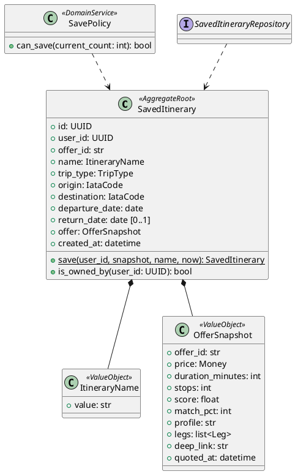

# Bounded Context: Itineraries (`src/modules/itineraries/`)

## 1. Propósito y límites

Permite al usuario **guardar** una oferta del podio para consultarla después, aunque la búsqueda haya expirado. Solo tiene cuatro operaciones: guardar, listar, ver y eliminar.

**No hace:** renombrar, notas, archivar, estados, versiones, actualizar precios, comparar ni compartir. El precio guardado es una foto del momento (RL-04): para un precio vigente hay que buscar de nuevo, y el *deep link* puede haber expirado.

Reglas: RN-13 y RL-02 de [navby-documentation.md](../../navby-documentation.md).

## 2. Lenguaje ubicuo

| Término | Significado |
| :--- | :--- |
| **Itinerario guardado** | Copia inmutable de una oferta del podio con los criterios de su búsqueda. |
| **Snapshot de oferta** | JSON congelado con la oferta tal como se mostró en el podio. |

## 3. Capa de dominio

### Agregado **SavedItinerary**

| Miembro | Descripción |
| :--- | :--- |
| `id` | UUID. |
| `user_id` | Dueño (ID lógico de IAM). |
| `offer_id` | ID determinista de la oferta (ver [flight-api-documentation.md](../flight-api-documentation.md#3-traducción-a-una-oferta-de-navby)). |
| `name` | **ItineraryName**. |
| `trip_type` | Copiado de la búsqueda. |
| `origin`, `destination` | Primer y último aeropuerto del tramo de ida **de la oferta** (no de la ciudad buscada). |
| `departure_date`, `return_date` | Copiadas de la búsqueda. |
| `offer` | **OfferSnapshot**. |
| `created_at` | |
| *save(user_id, snapshot, name \| None, now)* | Fábrica. Sin nombre, usa `"{origin} → {destination} · {departure_date}"`. |
| *is_owned_by(user_id)* | Control de acceso. |

El agregado es inmutable después de crearse: solo se crea o se elimina.

### Value objects

| Clase | Regla |
| :--- | :--- |
| **ItineraryName** | 1–80 caracteres, sin espacios al inicio ni al final. |
| **OfferSnapshot** | Mismo esquema que un elemento de `podium` en la respuesta de Quotes (`legs[]` con `direction` `OUTBOUND`/`INBOUND`, cada tramo con sus `segments[]`), más `profile`, `weights` y `quoted_at`. Se guarda como JSONB. |

### Servicio de dominio

**SavePolicy**: *can_save(current_count) -> bool*. Devuelve `current_count < 50`.

### Repositorio

**SavedItineraryRepository**:
- *add(itinerary)*, *get(id)*, *find_by_offer(user_id, offer_id)*, *delete(id)*;
- *list(user_id, page)*, *count(user_id)*;
- *lock_user(user_id)*: `pg_advisory_xact_lock` por usuario;
- *delete_all_for_user(user_id)*.

## 4. Capa de aplicación

| Handler | Entrada | Resultado | Errores |
| :--- | :--- | :--- | :--- |
| **SaveItinerary** | `user_id`, `search_id`, `offer_id`, `name?` | itinerario (`201` si es nuevo, `200` si ya existía) | `SEARCH_NOT_FOUND`, `OFFER_NOT_FOUND`, `ITINERARY_LIMIT_REACHED`, `VALIDATION_ERROR` |
| **ListItineraries** (query) | `user_id`, `page`, `page_size` (por defecto 20, máximo 50) | página de itinerarios, del más reciente al más antiguo | — |
| **GetItinerary** (query) | `user_id`, `id` | itinerario | `ITINERARY_NOT_FOUND` |
| **DeleteItinerary** | `user_id`, `id` | — | `ITINERARY_NOT_FOUND` |
| **DeleteUserItineraries** (evento `iam.user_deleted`) | `user_id` | — | — (idempotente) |

**SaveItinerary**, en una sola transacción:
1. Obtiene la oferta del servidor con *QuotesFacade.get_offer(user_id, search_id, offer_id)*. El cliente nunca envía el precio ni la oferta, así que no puede falsificarlos. Si la búsqueda expiró (30 min) → `SEARCH_NOT_FOUND`, y el usuario debe buscar de nuevo.
2. *lock_user(user_id)* para que dos guardados simultáneos no superen el límite.
3. Si ya existe un itinerario con ese `offer_id`, lo devuelve sin crear otro (idempotente).
4. Verifica *SavePolicy* con *count(user_id)* y crea el itinerario.

Si el itinerario pertenece a otro usuario, se responde `ITINERARY_NOT_FOUND` (no se revela que existe).

### Puerto

| Puerto | Método | Adaptador |
| :--- | :--- | :--- |
| **QuotesPort** | *get_offer(user_id, search_id, offer_id) -> Result[OfferSnapshot]* | Adaptador sobre **QuotesFacade** |

## 5. Capa de interfaces

| Endpoint | Handler |
| :--- | :--- |
| `POST /itineraries` | **SaveItinerary** |
| `GET /itineraries` | **ListItineraries** |
| `GET /itineraries/{id}` | **GetItinerary** |
| `DELETE /itineraries/{id}` | **DeleteItinerary** |

Contratos en [navby-endpoints.md](../navby-endpoints.md#6-itineraries). No expone fachada OHS.

## 6. Capa de infraestructura

- **PostgreSQL**: `itineraries.saved_itineraries` ([DDL](../navby-database-schema.md)) con `UNIQUE (user_id, offer_id)`. El snapshot va en `offer_snapshot JSONB`.

## 7. Diagrama de clases

