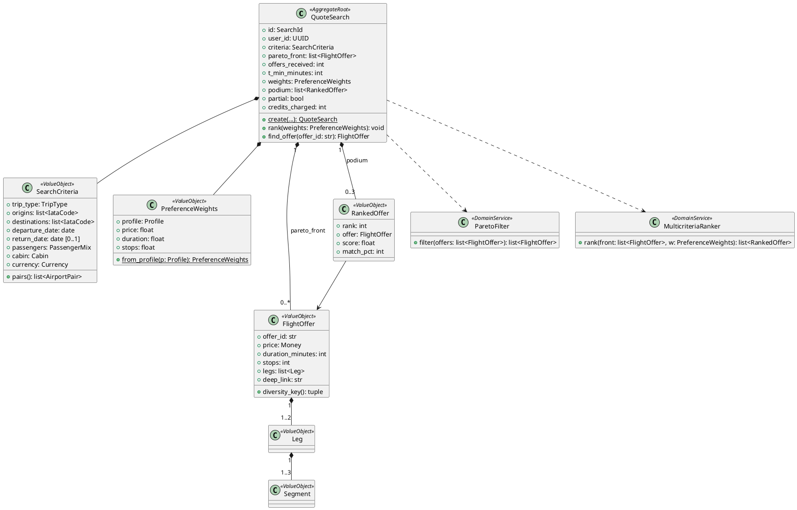

# Bounded Context: Quotes (`src/modules/quotes/`)

## 1. Propósito y límites

Convierte una búsqueda en el **podio**: obtiene ofertas reales de FlightAPI, filtra la frontera de Pareto, calcula el puntaje ponderado y elige las 3 mejores. Es el núcleo de valor de Navby.

**No hace:** calcular rutas sobre el grafo (lo pide a Routing), manejar saldos (lo pide a Billing), guardar itinerarios ni vender pasajes. No tiene tablas en PostgreSQL: todo su estado es efímero en Redis.

Reglas: RN-01 a RN-11, RN-14 a RN-16 y la sección 5.3 de [navby-documentation.md](../../navby-documentation.md).

## 2. Lenguaje ubicuo

| Término | Significado |
| :--- | :--- |
| **Búsqueda (QuoteSearch)** | Sesión con criterios, frontera de Pareto, T_min y pesos actuales. Dura 30 min. |
| **Oferta (FlightOffer)** | Itinerario real con precio total, duración, escalas, tramos y *deep link*. |
| **Frontera de Pareto** | Ofertas no dominadas en precio, duración y escalas. |
| **Puntaje (S)** | Distancia ponderada al ideal (0, 0, 0). Menor es mejor. |
| **Afinidad** | `round((1 − S) × 100)`. Es lo que ve el usuario. |
| **Perfil** | `BALANCED`, `SAVER`, `FAST` o `CUSTOM`, con sus pesos α, β y γ. |
| **Podio** | Top 1–3 por puntaje, sin repetir secuencias de aeropuertos. |

## 3. Capa de dominio

### Agregado **QuoteSearch**

| Miembro | Descripción |
| :--- | :--- |
| `id` | **SearchId** (`srch_` + ULID). |
| `user_id` | Dueño. Solo él puede reordenarla o leerla. |
| `criteria` | **SearchCriteria**. |
| `pareto_front` | `list[FlightOffer]`, ya filtrada. |
| `offers_received` | Total de ofertas antes del filtro. |
| `t_min_minutes` | Suma de T_min de ida (y de vuelta, si aplica). |
| `weights` | **PreferenceWeights** actuales. |
| `podium` | `list[RankedOffer]` (1–3). |
| `partial` | `True` si algún par falló en FlightAPI. |
| `credits_charged` | 0 o 5. |
| *create(...)* | Fábrica: recibe todas las ofertas, aplica **ParetoFilter** y luego *rank(weights)*. |
| *rank(weights)* | Recalcula el podio con **MulticriteriaRanker**. No muta `pareto_front`. |
| *find_offer(offer_id) -> FlightOffer \| None* | Usada por Itineraries. |

Invariantes: `pareto_front` no contiene ofertas dominadas, `podium` ⊆ `pareto_front` y `len(podium) = min(3, ofertas con distinta combinación de secuencia de aeropuertos y aerolíneas)`.

### Value objects

| Clase | Miembros | Validación |
| :--- | :--- | :--- |
| **SearchCriteria** | `trip_type`, `origins`, `destinations`, `departure_date`, `return_date`, `passengers`, `cabin`, `currency` | RN-01 a RN-04 y RN-06 (1–5 aeropuertos por lado, sin aeropuertos repetidos entre origen y destino). |
| **PassengerMix** | `adults`, `children`, `infants` | RN-02. |
| **AirportPair** | `origin`, `destination` | Distintos. *cache_key(criteria) -> str*. |
| **PreferenceWeights** | `profile`, `price`, `duration`, `stops` | Cada peso en [0, 1] y suma = 1 ± 0.001. *from_profile(profile)* aplica la tabla de la sección 5.4. |
| **FlightOffer** | `offer_id`, `price: Money`, `duration_minutes`, `stops`, `legs: list[Leg]`, `airlines`, `deep_link` | `price > 0`, `duration > 0` y `stops` por tramo ≤ 2. *diversity_key() -> (secuencia de aeropuertos, aerolíneas)*. |
| **Leg** | `direction` (`OUTBOUND`/`INBOUND`), `departure`, `arrival`, `duration_minutes`, `stops`, `segments` | |
| **Segment** | `from_iata`, `to_iata`, `departure`, `arrival`, `flight_number`, `airline_iata` | `departure` y `arrival` son hora local del aeropuerto. La zona IANA se agrega en el assembler desde Routing. |
| **Money** | `amount: Decimal`, `currency` | `amount ≥ 0`, `USD` o `PEN`. Se serializa con 2 decimales. |
| **RankedOffer** | `rank`, `offer`, `score`, `match_pct` | `score` ∈ [0, 1]. |

### Servicios de dominio

**ParetoFilter**: *filter(offers) -> list[FlightOffer]*

```text
para cada oferta a:
    dominada = existe b ≠ a con  b.price ≤ a.price  y  b.duration ≤ a.duration  y  b.stops ≤ a.stops
                              y  al menos una de las tres desigualdades es estricta
    conservar a si no está dominada
```

Si hay ofertas idénticas en los tres criterios, se conserva la de menor `offer_id`. Complejidad: O(N²), con N en decenas o cientos.

**MulticriteriaRanker**: *rank(front, weights) -> list[RankedOffer]*

0. Si `front` está vacío, devuelve `[]`.
1. Min y max de precio, duración y escalas sobre `front`.
2. `x' = (x − min) / (max − min)`; si `max = min`, entonces `x' = 0`.
3. `S = sqrt(α·p'² + β·t'² + γ·e'²)`.
4. Orden por (S, precio, duración, hora de salida, offer_id).
5. Recorrer el orden y tomar ofertas cuya *diversity_key()* no se haya elegido antes, hasta completar 3.
6. `match_pct = round((1 − S) × 100)`.

Complejidad: O(N log N).

## 4. Capa de aplicación

### **SearchQuotes** (comando)

Entrada: `user_id`, **SearchCriteria** y **PreferenceWeights**.

1. Validar criterios y pesos (`VALIDATION_ERROR`, `INVALID_WEIGHTS`).
2. Tomar el candado del usuario en **SearchLock** (RN-15). Si ya existe → `SEARCH_IN_PROGRESS`. El candado se libera al terminar, con éxito o error.
3. *RoutingFacade.select_pairs(origins, destinations, round_trip)* devuelve los ≤ 2 mejores pares alcanzables (RN-14). Si no hay ninguno → `ROUTE_NOT_REACHABLE` (sin costo).
4. T_min = menor T_min entre los pares elegidos (ida + vuelta si es ida y vuelta).
5. Leer de **OfferCache** cada par elegido.
6. Si algún par no está en caché: `search_id = new()`, *BillingFacade.debit_search(user_id, search_id)*. Si falla → `INSUFFICIENT_CREDITS`.
7. *FlightOffersProvider.fetch_offers* para los pares sin caché, en paralelo y a través de **ProviderGate** (RN-16). Guardar en caché solo las respuestas exitosas con al menos una oferta.
8. Reembolso (RN-09): si **todas** las llamadas fallaron, o si entre caché y FlightAPI hay 0 ofertas, llamar a *BillingFacade.refund_search* y dejar `credits_charged = 0`.
   - Todas fallaron y no hay ofertas en caché → `PROVIDER_UNAVAILABLE`.
   - Hay 0 ofertas en total → `200` con `podium: []` («no hay vuelos para esa fecha»), sin costo.
   - Falló solo un par → se continúa con lo obtenido y `partial = true`.
9. *QuoteSearch.create(...)*, guardar en **SearchSessionStore** y devolver **PodiumDTO**.

Si Redis no está disponible, la búsqueda responde `503 PROVIDER_UNAVAILABLE` **antes** de cobrar: sin sesión no se podría reordenar ni guardar el resultado.

### **RerankQuotes** (comando)

Entrada: `user_id`, `search_id` y **PreferenceWeights**. Carga la sesión, verifica al dueño, ejecuta *rank(weights)*, la guarda **conservando su expiración original** (RN-10) y devuelve **PodiumDTO** con `credits_charged = 0`. Errores: `SEARCH_NOT_FOUND`, `INVALID_WEIGHTS`.

### **GetQuoteSearch** (consulta)

Devuelve el podio vigente. Error: `SEARCH_NOT_FOUND`.

### Puertos

| Puerto | Métodos | Adaptadores |
| :--- | :--- | :--- |
| **FlightOffersProvider** | *fetch_offers(pair, criteria) -> Result[list[FlightOffer]]* | `FlightApiOffersProvider`, `MockFlightOffersProvider` ([detalle](../flight-api-documentation.md)) |
| **OfferCache** | *get(pair_key)*, *put(pair_key, offers)* | `RedisOfferCache` |
| **SearchSessionStore** | *get(search_id)*, *create(search)*, *update(search)* (mantiene el TTL restante con `KEEPTTL`) | `RedisSearchSessionStore` |
| **SearchLock** | *acquire(user_id) -> bool*, *release(user_id)* | `RedisSearchLock` (`SET NX EX 60`) |
| **ProviderGate** | *slot()* (context manager asíncrono, espera hasta 10 s) | `InMemoryProviderGate`: `asyncio.Semaphore(FLIGHT_API_MAX_CONCURRENCY)` (5 en LITE). Válido porque la plataforma corre con un solo worker de Uvicorn; si se agregan workers, el límite se divide entre ellos. |
| **RoutingPort** | *select_pairs(...)*, *get_airports(...)* | Adaptador sobre **RoutingFacade** |
| **BillingPort** | *debit_search(user_id, search_id)*, *refund_search(user_id, search_id)* | Adaptador sobre **BillingFacade** |

## 5. Capa de interfaces

| Endpoint | Handler | Dependencias |
| :--- | :--- | :--- |
| `POST /quotes/search` | **SearchQuotes** | *get_verified_user*, rate limit `quotes_search` |
| `POST /quotes/{search_id}/rank` | **RerankQuotes** | *get_verified_user* |
| `GET /quotes/{search_id}` | **GetQuoteSearch** | *get_verified_user* |

El assembler agrega a cada oferta del podio `extra_minutes_vs_t_min`, y a cada aeropuerto sus coordenadas y su zona horaria IANA (vía *RoutingFacade.get_airports*). Contratos en [navby-endpoints.md](../navby-endpoints.md#4-quotes).

### Fachada OHS: **QuotesFacade**

| Método | Retorno | Consumidor |
| :--- | :--- | :--- |
| *get_offer(user_id, search_id, offer_id)* | `Result[OfferSnapshotDTO]` (criterios + oferta + score + perfil) | Itineraries |

## 6. Capa de infraestructura

| Clave Redis | TTL | Contenido |
| :--- | :---: | :--- |
| `navby:quotes:offers:{pair_key}` | 1,800 s | Lista JSON de **FlightOffer** de un par. Formato de `pair_key` en [navby-database-schema.md](../navby-database-schema.md#3-redis-7). |
| `navby:quotes:search:{search_id}` | 1,800 s | **QuoteSearch** serializado. |
| `navby:quotes:lock:{user_id}` | 60 s | Candado de cotización en curso (RN-15). |

## 7. Diagrama de clases


