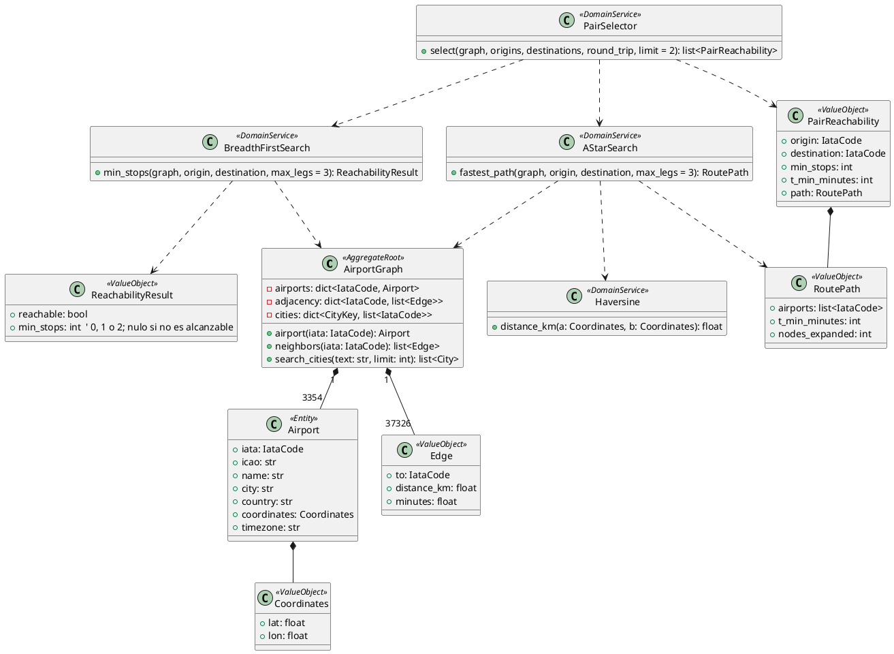

# Bounded Context: Routing (`src/modules/routing/`)

## 1. Propósito y límites

Mantiene en memoria el grafo aeroportuario de OpenFlights y responde dos preguntas sin costo externo:

1. **BFS**: ¿hay ruta con ≤ 2 escalas y cuántas escalas como mínimo?
2. **A\***: ¿cuál es la ruta físicamente más rápida (T_min) y por qué aeropuertos pasa?

También ofrece el catálogo de ciudades y aeropuertos para el buscador.

**No hace:** precios, horarios, disponibilidad ni recomendaciones (eso es Quotes). No persiste nada ni explora el grafo completo para el usuario.

Reglas: RN-05, RN-06, RN-07 y RN-14, y las secciones 5.1 y 5.2 de [navby-documentation.md](../../navby-documentation.md).

## 2. Lenguaje ubicuo

| Término | Significado |
| :--- | :--- |
| **Aeropuerto (nodo)** | Vértice identificado por su código IATA, con ciudad, país y coordenadas. |
| **Ruta directa (arista)** | Conexión dirigida `u → v` que existe en OpenFlights. No implica horario ni precio. |
| **Par** | Combinación origen–destino evaluada en una búsqueda. |
| **Escalas mínimas** | Aeropuertos intermedios de la ruta con menos tramos (BFS). |
| **T_min** | Duración estimada de la ruta más rápida con ≤ 2 escalas (A\*). |

## 3. Capa de dominio

### Agregado **AirportGraph** (solo lectura, singleton en RAM)

| Miembro | Descripción |
| :--- | :--- |
| `airports: dict[IataCode, Airport]` | 3,354 nodos. |
| `adjacency: dict[IataCode, list[Edge]]` | 37,326 aristas dirigidas. |
| `cities: dict[CityKey, list[IataCode]]` | Índice ciudad → aeropuertos para el autocompletado. Ver «Agrupación de ciudades». |
| *airport(iata) -> Airport \| None* | Búsqueda O(1). |
| *search_cities(text, limit) -> list[City]* | Coincidencia por prefijo en el nombre de la ciudad en inglés, su alias en español, el nombre del aeropuerto o el código IATA, sin distinguir mayúsculas ni tildes. |
| `out_degree: dict[IataCode, int]` | Rutas directas salientes por aeropuerto. Lo usa **PairSelector** como indicador de oferta comercial. |

Se construye una vez en `lifespan` y nunca cambia en ejecución.

**Agrupación de ciudades (RN-06).** `CityKey` = nombre de ciudad + país, normalizados sin tildes ni mayúsculas. Dentro de cada clave, los aeropuertos se agrupan solo si están a menos de 80 km entre sí. Así se separan homónimos lejanos, como Columbus (Ohio) y Columbus (Georgia), que comparten nombre y país en OpenFlights. OpenFlights registra algunos aeropuertos metropolitanos con otro nombre de ciudad (Newark `EWR`). `airport_city_overrides.csv` corrige esa ciudad antes de agrupar, así que EWR aparece dentro de New York (está a 26 km de JFK). En el dataset hay 3,216 ciudades con un aeropuerto, 59 con dos, 5 con tres y una (Londres) con cinco.

### Entidades y value objects

| Clase | Tipo | Miembros | Regla |
| :--- | :--- | :--- | :--- |
| **Airport** | Entidad | `iata`, `icao`, `name`, `city`, `country`, `coordinates`, `timezone` | Identidad por `iata`. |
| **IataCode** | VO | `value: str` | Coincide con `^[A-Z]{3}$`. |
| **Coordinates** | VO | `lat`, `lon` | lat ∈ [−90, 90], lon ∈ [−180, 180]. |
| **Edge** | VO | `to: IataCode`, `distance_km: float`, `minutes: float` | `minutes = distance_km / 800 · 60 + 30`. |
| **ReachabilityResult** | VO | `reachable: bool`, `min_stops: int \| None` | `min_stops` ∈ {0, 1, 2}. |
| **RoutePath** | VO | `airports: list[IataCode]`, `t_min_minutes: int`, `nodes_expanded: int` | 2 a 4 aeropuertos, sin repetidos. `t_min_minutes` es la suma en minutos redondeada al entero más cercano. |
| **PairReachability** | VO | `origin`, `destination`, `reachable`, `min_stops`, `t_min_minutes`, `path` | Resultado por par que consume Quotes. |

### Servicios de dominio

**BreadthFirstSearch**: *min_stops(graph, origin, destination, max_legs=3) -> ReachabilityResult*

- Cola FIFO (`collections.deque`) con el nivel de cada nodo y conjunto de visitados.
- Se detiene al encontrar el destino o al agotar el nivel 3.
- Complejidad: O(V + E) en el peor caso. En la práctica explora solo hasta 3 niveles.

**AStarSearch**: *fastest_path(graph, origin, destination, max_legs=3) -> RoutePath \| None*

- Estado `(aeropuerto, tramos_usados)`. Cola de prioridad `heapq` ordenada por `f = g + h`.
- Costo de una arista: `edge.minutes`, más 60 si el aeropuerto de salida no es el origen (penalización por escala).
- Heurística: `h(u) = haversine(u, destino) / 800 · 60`. Es admisible y consistente.
- Termina al extraer el destino de la cola. Devuelve la ruta, T_min y los nodos expandidos.
- Complejidad: O(K · E · log(K · V)) con K = 3.

**Haversine**: *distance_km(a: Coordinates, b: Coordinates) -> float*, con R = 6,371 km.

**PairSelector** (RN-14): *select(graph, origins, destinations, round_trip, limit=2) -> list[PairReachability]*

1. Forma todas las combinaciones origen–destino (como máximo 5 × 5 = 25). Si hay un solo par, lo evalúa directamente.
2. Ejecuta BFS en cada par y descarta los no alcanzables. En ida y vuelta, el par también debe ser alcanzable en sentido inverso.
3. Ejecuta A\* sobre los pares alcanzables.
4. Ordena por (escalas mínimas, −(out_degree(origen) + out_degree(destino)), T_min, origen, destino). En ida y vuelta, las escalas y T_min son la suma de ida y vuelta.
5. Devuelve los primeros `limit` pares.

El segundo criterio evita cotizar aeropuertos secundarios con poca oferta real (London City frente a Heathrow) cuando ambos tienen las mismas escalas mínimas. Costo: menos de 25 ejecuciones de BFS y A\*, unos pocos milisegundos.

## 4. Capa de aplicación

| Handler | Entrada | Resultado | Errores |
| :--- | :--- | :--- | :--- |
| **SearchCities** (query) | `q` (≥ 2 caracteres), `limit` ≤ 20 | ciudades con sus aeropuertos | `VALIDATION_ERROR` |
| **PreviewRoute** (query) | `origins[]` y `destinations[]` (1–5 aeropuertos cada uno, sin aeropuertos en común) y `trip_type` | pares elegidos por **PairSelector**, mejor ruta y telemetría | `AIRPORT_NOT_FOUND`, `VALIDATION_ERROR` |

**PreviewRoute** mide con `time.perf_counter()` el tiempo total de BFS y de A\* sobre todos los pares evaluados y el total de nodos expandidos, y los devuelve como telemetría. El assembler agrega a cada aeropuerto de la ruta sus coordenadas desde **AirportGraph**.

## 5. Capa de interfaces

| Endpoint | Handler |
| :--- | :--- |
| `GET /routing/cities` | **SearchCities** |
| `GET /routing/preview` | **PreviewRoute** (rate limit `routing_preview`) |

Contratos en [navby-endpoints.md](../navby-endpoints.md#3-routing).

### Fachada OHS: **RoutingFacade**

| Método | Retorno | Consumidor |
| :--- | :--- | :--- |
| *select_pairs(origins: list[str], destinations: list[str], round_trip: bool)* | `Result[list[PairReachabilityDTO]]` con los ≤ 2 pares elegidos, sus escalas mínimas y T_min | Quotes (filtro previo, selección de pares y T_min) |
| *get_airports(iatas: list[str])* | `list[AirportDTO]` (IATA, nombre, ciudad, coordenadas y zona IANA) | Quotes (coordenadas para dibujar el podio) |

## 6. Capa de infraestructura

- **CsvGraphLoader** lee `navby-datasets/airports.csv` y `navby-datasets/routes_unique.csv`, valida que existan 3,354 nodos y 37,326 aristas, aplica `navby-datasets/airport_city_overrides.csv`, carga `navby-datasets/city_aliases_es.csv` y construye **AirportGraph**. Si algún conteo no coincide, aborta el arranque.
- Los minutos de cada arista se precalculan al cargar.
- No hay tablas ni claves Redis. El grafo ocupa ~10 MB.

## 7. Diagrama de clases

