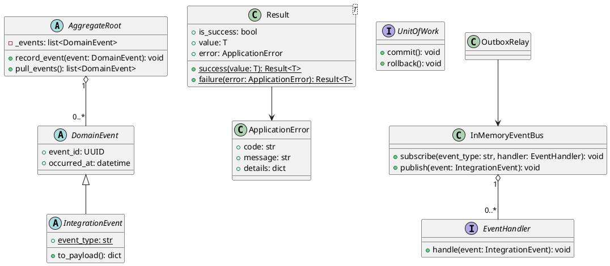

# Shared Kernel (`src/shared/`)

## 1. Propósito y límites

Contiene la infraestructura común que usan todos los bounded contexts: clases base del dominio, `Result`, errores HTTP, Unit of Work, Transactional Outbox, bus de eventos en memoria, autenticación de peticiones y rate limiting.

**No contiene reglas de negocio.** Nada de créditos, rutas, ofertas ni usuarios vive aquí. Si una clase solo la usa un contexto, pertenece a ese contexto.

## 2. Lenguaje ubicuo

| Término | Significado |
| :--- | :--- |
| **Agregado** | Grupo de objetos que cambia como una unidad y protege sus invariantes. |
| **Evento de integración** | Hecho publicado por un contexto para que otro reaccione más tarde (vía outbox). |
| **Outbox** | Tabla `shared.outbox_events`, donde los eventos se guardan en la misma transacción que el cambio. |
| **Result** | Valor de retorno de un handler: éxito con dato o fallo con `ApplicationError`. |

## 3. Capa de dominio (`src/shared/domain/`)

| Clase | Tipo | Miembros clave | Propósito |
| :--- | :--- | :--- | :--- |
| **AggregateRoot** | Clase base | `_events: list[DomainEvent]`, *record_event(event)*, *pull_events() -> list[DomainEvent]* | Acumula eventos hasta que la Unit of Work los persiste o despacha. |
| **DomainEvent** | `@dataclass(frozen=True)` | `event_id: UUID`, `occurred_at: datetime` | Base de todos los eventos. |
| **IntegrationEvent** | `DomainEvent` | `event_type: ClassVar[str]` (p. ej. `"iam.user_verified"`), *to_payload() -> dict* | Evento que sale del contexto vía outbox. |
| **DomainError** | Excepción base | `code: str`, `message: str` | Violación de una invariante dentro del dominio. El handler la convierte en `Result.failure`. |

## 4. Capa de aplicación (`src/shared/application/`)

| Clase | Miembros clave | Propósito |
| :--- | :--- | :--- |
| **ApplicationError** | `code: str`, `message: str`, `details: dict` | Error de negocio serializable. Los códigos están en el catálogo de la [especificación táctica](../navby-backend-tactical-specification.md#catálogo-de-códigos-de-error). |
| **Result[T]** | *success(value)*, *failure(error)*, `is_success`, `value`, `error` | Control de flujo sin excepciones. |
| **UnitOfWork** (Protocol) | `async with uow:`, *commit()*, *rollback()*, `session` | Transacción única: agregados más eventos del outbox. |
| **EventHandler** (Protocol) | *handle(event: IntegrationEvent) -> None* | Contrato de los consumidores de eventos. Debe ser idempotente. |
| **CurrentUser** | `user_id: UUID`, `email: str`, `email_verified: bool` | Identidad autenticada que reciben los routers. |

## 5. Capa de interfaces (`src/shared/interfaces/`)

| Componente | Propósito |
| :--- | :--- |
| *get_current_user()* | Dependencia de FastAPI que valida el JWT (HS256, `JWT_SECRET`) y devuelve **CurrentUser**. Si falla → `401 UNAUTHENTICATED`. |
| *get_verified_user()* | Igual que la anterior, pero exige `email_verified`. Si no → `403 EMAIL_NOT_VERIFIED`. |
| *rate_limit(scope, key_fn, limit)* | Dependencia de ventana fija en Redis. Si se supera → `429 RATE_LIMITED`. |
| *to_http(result)* | Convierte un `Result` fallido en una respuesta RFC 7807 según el catálogo de códigos. |
| **ProblemDetails** | Schema Pydantic del error RFC 7807 (`type`, `title`, `status`, `detail`, `instance`, `code`, `invalid_params`). |
| **Page[T]** | Schema de paginación: `items`, `page`, `page_size`, `total`. |
| Manejador global | Transforma las excepciones no controladas en `500 INTERNAL_ERROR` sin exponer trazas. |

El JWT lo emite IAM. El Shared Kernel solo lo **valida** con la misma clave, así que ningún contexto depende de IAM para autenticar una petición.

## 6. Capa de infraestructura (`src/shared/infrastructure/`)

| Componente | Propósito |
| :--- | :--- |
| **SqlAlchemyUnitOfWork** | Implementa **UnitOfWork** con `AsyncSession`. En el *commit* inserta en `shared.outbox_events` los **IntegrationEvent** extraídos de los agregados guardados. |
| **OutboxModel** | Modelo ORM de `shared.outbox_events` (DDL en [navby-database-schema.md](../navby-database-schema.md)). |
| **OutboxRelay** | Tarea asíncrona iniciada en `lifespan`. Cada 2 s lee hasta 50 eventos pendientes con `FOR UPDATE SKIP LOCKED`, los publica en el bus y marca `processed_at`. Si un evento falla, incrementa `attempts`; al quinto intento marca `failed_at` y guarda `last_error`. Al marcar `failed_at` escribe un log de nivel `CRITICAL` con el `event_type` y el `id`. El comando `uv run python -m src.shared.outbox retry <id>` limpia `failed_at` y `attempts` para reintentarlo. |
| **InMemoryEventBus** | Registro `event_type → [EventHandler]`. Los contextos suscriben sus handlers al arrancar. |
| **RedisClient** | Fábrica de la conexión `redis.asyncio` compartida. |
| **Settings** | `pydantic-settings` con las variables de entorno de [navby-platform-documentation.md](../navby-platform-documentation.md#variables-de-entorno). |
| **PeriodicTasks** | Registro de tareas periódicas iniciadas en `lifespan` con `asyncio`: el relay del outbox (cada 2 s), **ExpirePendingOrders** de Billing (cada hora) y **PurgeExpiredTokens** de IAM (cada 24 h). Corren en el único worker de Uvicorn. |

## 7. Diagrama de clases

