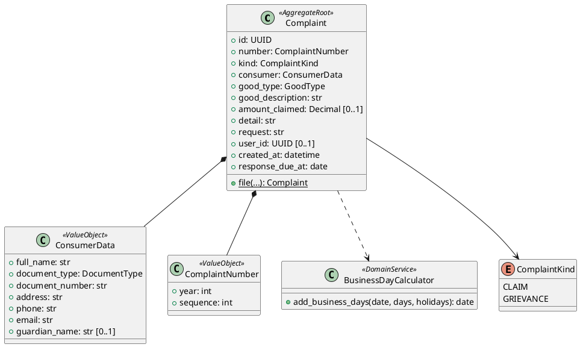

# Bounded Context: Support (`src/modules/support/`)

## 1. Propósito y límites

Implementa el **Libro de Reclamaciones virtual** que exige la Ley 29571 (RL-03 en [navby-documentation.md](../../navby-documentation.md)). Registra cada reclamo o queja con un número correlativo, entrega la constancia al consumidor y avisa al equipo.

**No hace:** chat de soporte, tickets, respuestas dentro del sistema ni panel de administración. El equipo responde por correo desde fuera de la plataforma, dentro del plazo legal de 15 días hábiles.

## 2. Lenguaje ubicuo

| Término | Significado |
| :--- | :--- |
| **Reclamo** | Disconformidad con el producto o servicio adquirido (paquete de créditos, búsqueda). |
| **Queja** | Disconformidad con la atención, no relacionada con el producto. |
| **Hoja de reclamación** | Registro completo de un reclamo o queja con su número correlativo. |
| **Número correlativo** | `LR-{año}-{secuencia de 6 dígitos}` (p. ej. `LR-2026-000014`). Se reinicia cada año. |

## 3. Capa de dominio

### Agregado **Complaint**

| Miembro | Regla |
| :--- | :--- |
| `id` | UUID. |
| `number` | **ComplaintNumber**. Se asigna al guardar y no cambia. |
| `kind` | `CLAIM` (reclamo) o `GRIEVANCE` (queja). |
| `consumer` | **ConsumerData**. |
| `good_type` | `PRODUCT` o `SERVICE`. |
| `good_description` | 1–300 caracteres (p. ej. «Paquete Viajero Frecuente»). |
| `amount_claimed` | Decimal ≥ 0, en PEN. Opcional. |
| `detail` | 10–2,000 caracteres. Hechos del reclamo. |
| `request` | 10–1,000 caracteres. Lo que pide el consumidor. |
| `user_id` | Opcional. Se guarda si el reclamo se envía con sesión iniciada. |
| `created_at` | Fecha de presentación. |
| `response_due_at` | `created_at` + 15 días hábiles (lunes a viernes, sin feriados nacionales del Perú). |
| *file(...)* | Fábrica. Valida todo y registra **ComplaintFiled**. |

### Value objects

| Clase | Miembros | Regla |
| :--- | :--- | :--- |
| **ConsumerData** | `full_name`, `document_type` (`DNI`, `CE`, `PASAPORTE`), `document_number`, `address`, `phone`, `email`, `guardian_name?` | DNI: 8 dígitos. CE: 9–12 caracteres. Correo válido. `guardian_name` es obligatorio si el consumidor declara ser menor de edad. |
| **ComplaintNumber** | `year`, `sequence` | Formato `LR-AAAA-NNNNNN`. |

### Servicio de dominio

**BusinessDayCalculator**: *add_business_days(date, days, holidays) -> date*. Lee los feriados desde `resources/pe_holidays.json`, que se actualiza cada año.

### Eventos

| Evento | Tipo | Efecto |
| :--- | :--- | :--- |
| **ComplaintFiled** | Dominio (interno) | Después del commit se envían dos correos: la constancia al consumidor y el aviso al equipo (`SUPPORT_EMAIL`). |

### Repositorio

**ComplaintRepository**: *add(complaint)* (asigna el número con una secuencia PostgreSQL por año dentro de la transacción) y *get_by_number(number)*.

## 4. Capa de aplicación

| Handler | Entrada | Resultado | Errores |
| :--- | :--- | :--- | :--- |
| **FileComplaint** | datos del formulario, `user_id?` | `number`, `created_at`, `response_due_at` | `VALIDATION_ERROR` |

Si el envío de correos falla, el reclamo **ya quedó registrado**: se responde `201` igual, se registra el error y se reintenta el envío por outbox (`support.complaint_filed`).

### Puerto

| Puerto | Métodos | Adaptador |
| :--- | :--- | :--- |
| **ComplaintNotifier** | *send_receipt(complaint)*, *notify_team(complaint)* | `ResendComplaintNotifier`, `LogComplaintNotifier` (desarrollo) |

La constancia incluye los datos del proveedor exigidos por la norma (razón social, RUC y dirección), tomados de las variables `COMPANY_NAME`, `COMPANY_RUC` y `COMPANY_ADDRESS`.

## 5. Capa de interfaces

| Endpoint | Handler | Acceso |
| :--- | :--- | :--- |
| `POST /complaints` | **FileComplaint** | Público. Rate limit `complaints` (3 por minuto por IP). Si llega un JWT válido, se asocia el `user_id`. |

Contrato en [navby-endpoints.md](../navby-endpoints.md#7-support). El formulario vive en el website (`/es/reclamaciones` y `/en/reclamaciones`) y la webapp enlaza a él desde el pie de página.

## 6. Capa de infraestructura

- **PostgreSQL**: `support.complaints` y la secuencia `support.complaint_seq_{año}` ([DDL](../navby-database-schema.md)).
- **Outbox**: `support.complaint_filed` reintenta los correos que fallaron.
- Los reclamos se conservan al menos 2 años, como exige la norma. Si el usuario elimina su cuenta, el reclamo **no** se borra.

## 7. Diagrama de clases

