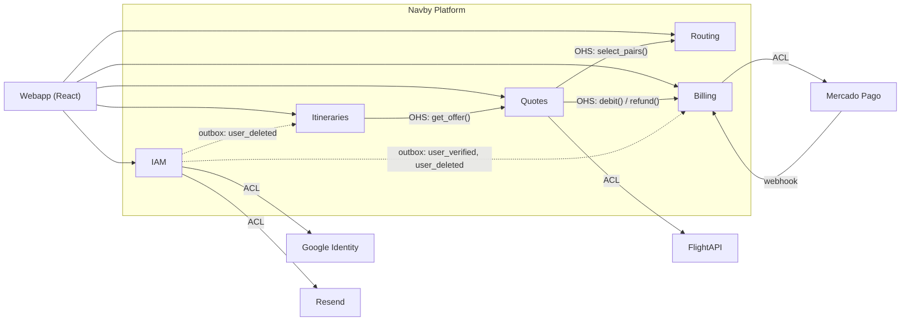
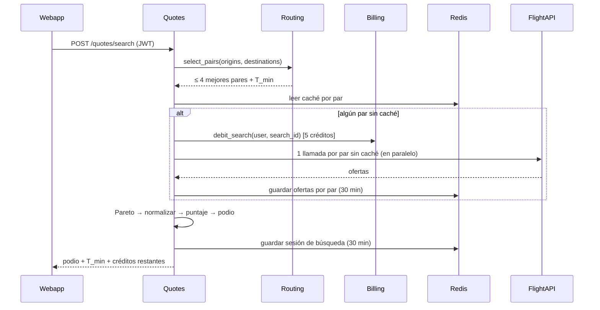

# Navby Platform — Arquitectura del Backend

> Las reglas de producto (créditos, pesos, límites) están en [navby-documentation.md](../navby-documentation.md). Este documento explica **cómo** está construido el backend que las cumple.

## 1. Visión general

Navby Platform es un **monolito modular** asíncrono en Python. Mantiene el grafo aeroportuario en memoria, cotiza ofertas reales en FlightAPI, calcula el podio multicriterio y gestiona usuarios, créditos e itinerarios guardados.

| Principio | Decisión |
| :--- | :--- |
| Un solo despliegue | Un proceso FastAPI con módulos (bounded contexts) aislados. Sin microservicios. |
| Grafo en RAM | 3,354 nodos y 37,326 aristas en estructuras nativas de Python (~10 MB). Sin Neo4j ni NetworkX. |
| Estado durable en PostgreSQL | Usuarios, créditos, órdenes, itinerarios y outbox. Una sola fuente de verdad por dato. |
| Estado efímero en Redis | Caché de ofertas, sesiones de búsqueda, códigos OTP y rate limiting. Nada en Redis es irrecuperable. |
| Sin broker de mensajes | Transactional Outbox sobre PostgreSQL + bus en memoria. |
| Costo externo protegido | BFS antes de cualquier llamada, caché de 30 min y débito previo de créditos. |

## 2. Stack

| Capa | Tecnología | Uso |
| :--- | :--- | :--- |
| Lenguaje y entorno | Python 3.12+, `uv`, Ruff, Mypy, pytest | Código, dependencias (`uv.lock`), lint, tipos y pruebas. |
| Web | FastAPI, Pydantic v2, Uvicorn | API REST, validación y OpenAPI 3.1 (`/docs`). |
| Persistencia | PostgreSQL 16, SQLAlchemy 2.0 async, asyncpg, Alembic | Datos durables y migraciones. |
| Memoria | Redis 7, `redis-py` (asyncio) | Caché, sesiones de búsqueda, OTP y rate limiting. |
| Seguridad | `bcrypt` (12 rondas), `PyJWT` (HS256), `google-auth` | Contraseñas, tokens de acceso y login con Google. |
| Integraciones | `httpx`, SDK `mercadopago`, SDK `resend` | FlightAPI, Mercado Pago y correo. |
| Infraestructura | Docker Compose, Caddy 2, Ubuntu 24.04 en Azure VM `Standard_B2s` (2 vCPU, 4 GB) | Despliegue, TLS automático y proxy inverso. |

## 3. Bounded contexts

| Contexto | Tipo | Responsabilidad | Estado | Documento |
| :--- | :---: | :--- | :--- | :--- |
| **Routing** | Core | Grafo en memoria, BFS, A\*, catálogo de ciudades y vista previa de ruta. | RAM (sin tablas) | [routing](extended-bounded-contexts-description/bounded-context-routing.md) |
| **Quotes** | Core | FlightAPI, caché, motor multicriterio y podio. | Redis (sin tablas) | [quotes](extended-bounded-contexts-description/bounded-context-quotes.md) |
| **Billing** | Supporting | Billetera, créditos diarios, débitos, reembolsos y compras con Mercado Pago. | PostgreSQL | [billing](extended-bounded-contexts-description/bounded-context-billing.md) |
| **Itineraries** | Supporting | Guardar, listar, ver y eliminar ofertas del podio. | PostgreSQL | [itineraries](extended-bounded-contexts-description/bounded-context-itineraries.md) |
| **IAM** | Generic | Registro con términos, verificación de correo, login local y con Google, sesiones, recuperación de contraseña y eliminación de cuenta. | PostgreSQL + Redis | [iam](extended-bounded-contexts-description/bounded-context-iam.md) |
| **Shared Kernel** | — | Clases base, `Result`, errores, outbox, Unit of Work y rate limiting. | — | [shared](extended-bounded-contexts-description/bounded-context-shared.md) |

## 4. Mapa de contextos



| Proveedor | Consumidor | Patrón | Contrato |
| :--- | :--- | :--- | :--- |
| Routing | Quotes | Open Host Service | `RoutingFacade.select_pairs(origins, destinations, round_trip) -> list[PairReachability]` |
| Billing | Quotes | Open Host Service | `BillingFacade.debit_search(user_id, search_id)` y `refund_search(user_id, search_id)` |
| Quotes | Itineraries | Open Host Service | `QuotesFacade.get_offer(user_id, search_id, offer_id) -> OfferSnapshot` |
| IAM | Billing | Outbox (asíncrono) | `iam.user_verified` → Billing crea la billetera. `iam.user_deleted` → Billing anula los créditos. |
| IAM | Itineraries | Outbox (asíncrono) | `iam.user_deleted` → Itineraries borra los itinerarios del usuario. |
| IAM | Todos | Dependencia FastAPI | `get_current_user()` (Shared Kernel) valida el JWT emitido por IAM y entrega `CurrentUser(user_id, email, email_verified)`. |
| FlightAPI | Quotes | Anti-Corruption Layer | `FlightOffersProvider` traduce el JSON de FlightAPI a `FlightOffer`. |
| Mercado Pago | Billing | Anti-Corruption Layer | `PaymentGateway` crea preferencias y consulta pagos. |
| Google | IAM | Anti-Corruption Layer | `GoogleIdentityVerifier` valida el `id_token`. |
| Resend | IAM | Anti-Corruption Layer | `EmailSender` envía OTP y enlaces de recuperación. |

Reglas de integración:

1. **Sin claves foráneas entre contextos.** Se enlaza por IDs lógicos (`user_id`).
2. **Llamadas síncronas solo por fachada OHS.** Un contexto nunca importa repositorios, entidades ni ORM de otro.
3. **Cambios que otro contexto debe conocer más tarde** se publican por outbox.

## 5. Secuencia de una búsqueda



Si todas las llamadas a FlightAPI fallan, Quotes llama a `refund_search`. Responde `503` si tampoco hay ofertas en caché; si las hay, responde con ellas y `partial: true` (RN-09).

## 6. Estructura de un bounded context

Todos los contextos siguen la misma plantilla en `src/modules/<context>/`:

```text
src/modules/<context>/
├── domain/
│   ├── model/
│   │   ├── aggregates/        # Raíces de agregado
│   │   ├── entities/          # Entidades internas
│   │   ├── value_objects/     # Value objects inmutables y enums
│   │   └── events/            # Eventos de dominio
│   ├── services/              # Lógica de dominio pura
│   ├── repositories/          # Contratos (typing.Protocol)
│   └── exceptions.py          # Errores de dominio
├── application/
│   ├── commands/              # Comandos + handlers (escritura)
│   ├── queries/               # Consultas + handlers (lectura)
│   ├── event_handlers/        # Consumidores de eventos
│   └── acl/ports/             # Puertos de salida hacia externos u otros contextos
├── infrastructure/
│   ├── persistence/           # Modelos ORM, repositorios y mappers
│   ├── adapters/              # Adaptadores ACL reales y mocks
│   └── cache/                 # Repositorios Redis
└── interfaces/
    ├── rest/                  # Router, schemas Pydantic y assemblers
    └── acl/facade/            # Fachada OHS que consumen otros contextos
```

Regla de dependencias: `interfaces → application → domain ← infrastructure`. El dominio no importa FastAPI, Pydantic, SQLAlchemy ni Redis. Detalle en la [especificación táctica](navby-backend-tactical-specification.md).

## 7. Ciclo de vida

Al arrancar (`lifespan` de FastAPI):

1. Cargar `airports.csv`, `routes_unique.csv`, `airport_city_overrides.csv` y `city_aliases_es.csv` y construir el grafo en memoria.
2. Abrir el pool de PostgreSQL (asyncpg) y la conexión a Redis.
3. Registrar los handlers de eventos y lanzar el *outbox relay* (tarea asíncrona).
4. Iniciar las tareas periódicas: **ExpirePendingOrders** (cada hora) y **PurgeExpiredTokens** (cada 24 h).

Si el grafo no carga, la aplicación no arranca. `/health` reporta PostgreSQL, Redis y grafo.

**Un solo worker de Uvicorn.** El grafo, el semáforo global de FlightAPI (RN-16) y las tareas periódicas viven en un proceso. Un segundo worker duplicaría la memoria del grafo, dividiría el semáforo y repetiría las tareas; si algún día se necesita, primero hay que mover esas piezas a Redis.

## 8. Despliegue

| Servicio (Docker Compose) | Imagen | Exposición |
| :--- | :--- | :--- |
| `platform` | Python 3.12 + Uvicorn | Interno `:8000` |
| `postgres` | `postgres:16` | Interno |
| `redis` | `redis:7` | Interno |
| `caddy` | `caddy:2` | Público `:80` y `:443` (TLS automático con Let's Encrypt) |

La VM solo expone los puertos 80, 443 y 22. El crédito de Azure de $100 USD alcanza para más de 3 meses 24/7 en `Standard_B2s`.

### Variables de entorno

| Variable | Uso |
| :--- | :--- |
| `DATABASE_URL`, `REDIS_URL` | Conexiones. |
| `JWT_SECRET` | Firma HS256 de los tokens de acceso. |
| `GOOGLE_CLIENT_ID` | Audiencia esperada del `id_token` de Google. |
| `FLIGHT_API_KEY` | Clave de FlightAPI. Si falta, se usa el adaptador mock. |
| `MERCADOPAGO_ACCESS_TOKEN`, `MERCADOPAGO_WEBHOOK_SECRET` | Pagos y validación de webhooks. |
| `RESEND_API_KEY` | Correo. Si falta, el OTP se escribe en el log (solo desarrollo). |
| `WEBAPP_URL` | URL base para enlaces de recuperación y retorno de pagos. También es el único origen permitido por CORS con credenciales. |
| `FLIGHT_API_MAX_CONCURRENCY` | Llamadas simultáneas permitidas por el plan de FlightAPI (5 en LITE, RN-16). |
| `TERMS_VERSION` | Versión vigente de los Términos y la Política de Privacidad (RL-01). |

### Modos de desarrollo (costo cero)

| Integración | Modo local |
| :--- | :--- |
| FlightAPI | `MockFlightOffersProvider` con fixtures JSON deterministas. |
| Mercado Pago | Credenciales sandbox y tarjetas de prueba. |
| Resend | Escritura del correo en el log. |
